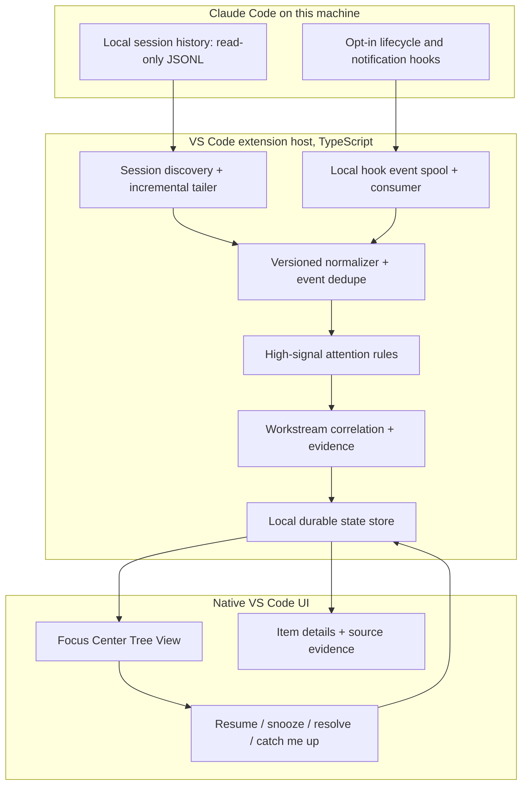

# Architecture — v0.1

## Design goal

Ship a trustworthy *attention queue*, not an autonomous orchestration platform. Keep a thin adapter over Claude Code's changing session data and a separate normalization boundary before any UI or workflow logic.



For file/module boundaries and test matrix see [Engineering contracts](IMPLEMENTATION-CONTRACTS.md).

## Planned components

| Component | Responsibility | Explicit boundary |
| --- | --- | --- |
| `adapters/claudeSessions` | Discover, parse and tail local JSONL sessions by file offset | Never write original transcripts; tolerate schema drift |
| `adapters/claudeHooks` | Opt-in hook installation and small JSON event spool | Preserve existing user configuration; no blocking hook actions |
| `adapters/claudeAgents` (optional) | Query `claude agents --json` only if installed version supports it | Use for a separate actual-running indicator, not to infer workstream completion |
| `domain/normalizer` | Convert source messages and hooks into normalized events | Versioned, idempotent, parser tests |
| `domain/attention` | Infer actionable events from high-signal signals and explicit wording | Rule-based for MVP; uncertain cases never assert verified status |
| `domain/workstreams` | Exact-link and repo+branch correlation | Preserve source identities; manual overrides win |
| `storage` | Local JSON snapshot plus append-only event log for v0.1 | Atomic writes; migration/version markers; no raw transcript copies |
| `ui` | Tree Data Provider, commands, details and Catch Me Up | No domain rules in UI; accessible, keyboard-operable |

### Why JSON initially?

For one local user and a modest attention queue, an atomic JSON snapshot plus bounded event log is easier to package in a VS Code extension than a native SQLite dependency. Provide an interface to migrate to SQLite if profiling demonstrates a need. Do not write the original raw transcript to this state store.

## Data contracts

```ts
interface SessionRef {
  source: 'claude-local';
  sessionId: string;
  cwd: string;
  transcriptPath?: string;
  repoRoot?: string;
  gitBranch?: string;
  lastSeenAt: string;
}

interface EvidenceRef {
  sessionId: string;
  eventId: string; // stable source identifier or hash
  kind: 'hook' | 'message' | 'user-action';
  timestamp: string;
  messageUuid?: string;
  excerpt?: string; // bounded and sanitized
}

type AttentionStatus =
  | 'needs-you' | 'in-progress' | 'waiting' | 'resolved' | 'uncertain';

interface AttentionItem {
  id: string;
  workstreamId: string;
  kind: 'permission' | 'decision' | 'failure' | 'review' | 'task' | 'other';
  status: AttentionStatus;
  title: string;
  nextAction?: string;
  owner: 'you' | 'claude' | 'external' | 'unknown';
  priority: 0 | 1 | 2;
  evidence: EvidenceRef[];
  sourceSessionIds: string[];
  confidence: 'direct' | 'inferred' | 'unknown';
  acknowledgedAt?: string;
  snoozedUntil?: string;
  manuallyResolvedAt?: string;
  updatedAt: string;
}
```

## Data flow details

1. **Cold start:** enumerate allowed local session roots, find recent session files, parse metadata and recent content with file-size bounds, persist offsets/mtime.
2. **Hook ingest:** Claude emits `SessionStart`, `UserPromptSubmit`, `Notification`, `PermissionRequest`, `TaskCreated`, `TaskCompleted`, `Stop`, `StopFailure`, `SessionEnd` as configured. A lightweight command hook writes a **minimal sanitized event** to a local spool; it exits 0 even when the dashboard is closed.
3. **Normalize:** key by `(source, sessionId, eventId)`, preserve timestamps and verified provenance, ignore duplicate replays; invalid/incomplete JSONL gets retried after next file change.
4. **Optional runtime snapshot:** when the installed Claude Code supports it, a low-frequency `claude agents --json` probe can annotate currently active background sessions. Do not persist full output; unavailable status is unknown.
5. **Extract attention:** direct events take precedence. Heuristic text classification only when the message explicitly asks for a decision, review, or action; anything else is Uncertain. No model calls in v0.1.
6. **Correlate:** use exact issue/ticket tokens, normalized repository/branch, or user-selected linking. Do not auto-collapse unrelated sessions.
7. **State reducer:** event-sourced transitions plus user overrides. `Stop` means Claude ended a turn, not "task complete"; `TaskCompleted` means a Claude task is reported complete, not necessarily tested/approved.
8. **Render:** update native tree and local detail view. "Catch Me Up" compares change log from a durable user checkpoint.

## Deep linking / resume

Use `vscode.window.createTerminal({cwd})` and a shell-safe call equivalent to `claude -r <session-id>`. This **starts/resumes** the local session; it does not promise to focus an already-running Claude terminal. Detect missing CLI and warn. Never shell-interpolate an unvalidated ID or repository path.

## Risks and mitigations

- **Claude JSONL is not a public stability contract:** isolate behind adapter and test against multiple fixture shapes; hooks include a documented `transcript_path`.
- **Hooks can be disabled/blocked:** show collection health, last event timestamp, and partial coverage; no false "all sessions monitored" banner.
- **Race conditions and duplicate hooks:** idempotent event IDs, atomic snapshots, append-only spool, debounce watcher, periodic scan fallback.
- **Incorrect resolution:** require direct evidence or user confirmation; record source and allow reopen.
- **Cost/security of semantic LLM processing:** defer to an explicit opt-in follow-up with provider and redaction policy.

## Official implementation references

- https://code.claude.com/docs/en/hooks
- https://code.claude.com/docs/en/cli-reference
- https://code.visualstudio.com/api/extension-guides/tree-view